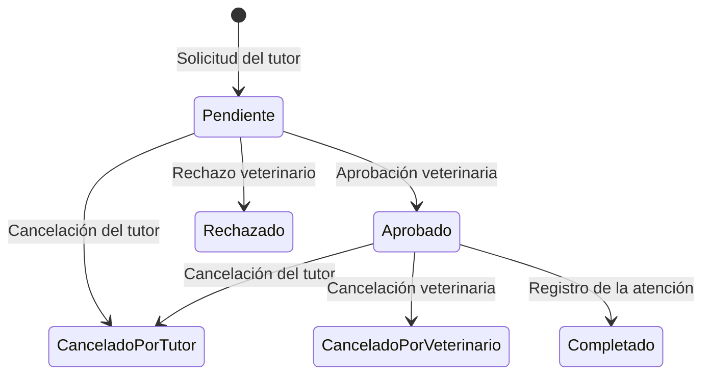
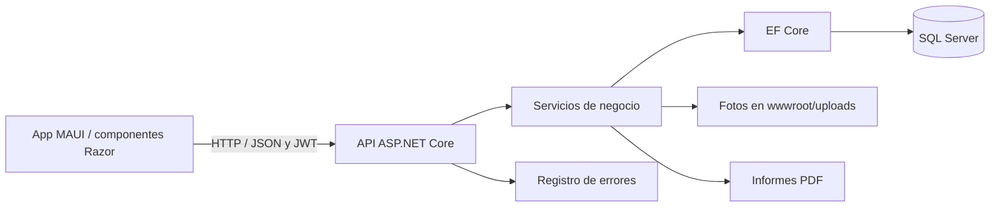

# Turnero Peluquería

Sistema de gestión de turnos para una peluquería canina, compuesto por una aplicación móvil .NET MAUI Blazor Hybrid y una API REST con ASP.NET Core y SQL Server. Permite que los tutores soliciten atención para sus perros, que los veterinarios organicen la disponibilidad y registren los servicios realizados, y que la administración consulte la actividad del establecimiento.

El proceso abarca desde la solicitud hasta la finalización del turno, con control de cupos diarios, antecedentes de cada mascota y restricciones de reserva por cancelaciones reiteradas.

## Funcionalidades por rol

| Rol | Funcionalidades disponibles en la aplicación |
| --- | --- |
| **Tutor** | Consultar sus perros, ver cupos disponibles, solicitar turnos con uno a diez servicios, cancelar solicitudes pendientes o aprobadas y consultar estados e historial. |
| **Veterinario** | Gestionar tutores y teléfonos, registrar y editar perros, subir o reemplazar sus fotos, consultar patologías, administrar cupos diarios y catálogos de servicios, tratamientos y patologías; aprobar, rechazar, cancelar y completar turnos indicando servicios realizados y observaciones. |
| **Administrador** | Gestionar veterinarios y catálogos, consultar movimientos de auditoría y errores de la API, consultar informes por período y generar sus PDF. |

El administrador crea las cuentas de los veterinarios y estos registran a los tutores. Los permisos se comprueban en la API; las consultas del tutor se restringen a sus propias mascotas y turnos.

**Alcance actual de la interfaz.** La API también implementa el cambio de contraseña, la asignación y edición de patologías de un perro, el borrado de su foto, la aplicación y el levantamiento de vetos y las reservas presenciales para tutores vetados. Estas operaciones todavía no cuentan con su correspondiente acción o formulario en la app. El registro de tratamientos y sus motivos al completar un turno también está implementado en la API, pero su selección está pendiente en la pantalla de finalización.

## Cómo se gestiona un turno



- **Disponibilidad por día.** Cada solicitud reserva inicialmente un cupo. Al aprobarla, el veterinario puede ajustar la cantidad ocupada si existe disponibilidad. Los turnos pendientes, aprobados y completados consumen capacidad; rechazar o cancelar libera la reserva.
- **Validación de la solicitud.** No se admiten fechas pasadas, servicios repetidos ni más de un turno activo del mismo perro para el mismo día. Si para la fecha solicitada el perro tendrá menos de 45 días y no tiene el calendario de vacunación completo, la solicitud se rechaza.
- **Finalización de la atención.** Solo puede completarse un turno aprobado cuya fecha ya haya llegado. Se distinguen los servicios solicitados de los efectivamente realizados y se conservan las observaciones y los tratamientos registrados.
- **Vetos de reserva.** Tres cancelaciones del tutor generan un veto automático, con un conteo que se reinicia tras una atención completada o el levantamiento de un veto. El veterinario también puede aplicar vetos manuales. Un tutor vetado conserva la posibilidad de recibir una reserva presencial gestionada por un veterinario mediante la API.

## Arquitectura y persistencia



La app ejecuta sus componentes Razor dentro de una vista web nativa. Sus clientes por módulo utilizan `HttpClient`; `SesionService` administra el estado de autenticación y guarda el token y su vencimiento en el almacenamiento seguro del dispositivo. Al restaurar una sesión, consulta el perfil en la API.

En el backend, los controladores exponen los recursos y aplican permisos por rol. Los servicios concentran procesos como las transiciones de turnos, los vetos, las bajas, las imágenes y los informes. Los DTO definen los datos intercambiados y `AppDbContext` aplica las configuraciones del modelo relacional.

El modelo contiene **20 entidades**. Separa las cuentas de usuario de los perfiles de tutor y veterinario; vincula cada perro con su tutor, sus patologías y su imagen; y relaciona los turnos con los cupos, servicios y tratamientos. Las migraciones definen el esquema y la carga inicial de catálogos. Las relaciones restringen los borrados en cascada para proteger la información vinculada.

## Tecnologías principales

| Responsabilidad | Tecnología |
| --- | --- |
| Aplicación móvil | .NET MAUI Blazor Hybrid, componentes Razor y C#; destino Android `net10.0-android`, mínimo Android 7.0 / API 24. |
| API REST | ASP.NET Core sobre `net10.0`. |
| Persistencia | SQL Server y Entity Framework Core **10.0.14**; herramienta local `dotnet-ef` **10.0.14**. |
| Autenticación | JwtBearer **10.0.14**, JWT firmado con HMAC-SHA256 y `PasswordHasher<Usuario>`. |
| Documentación de API | Swagger/OpenAPI con Swashbuckle **10.3.1**. |
| Informes e imágenes | QuestPDF **2026.9.1** y SkiaSharp **4.153.1**, con assets nativos para Linux. |
| Registro de errores | Serilog.Extensions.Logging **10.0.0** y Serilog.Sinks.File **7.0.0**. |
| Verificación funcional | ASP.NET Core MVC Testing y EF Core SQLite **10.0.14**; pruebas opcionales con SQL Server y Kestrel. |

El proyecto MAUI declara además destinos para iOS, Mac Catalyst y Windows según el sistema de compilación. El flujo de ejecución móvil documentado en el repositorio es Android; las versiones de MAUI se resuelven mediante `$(MauiVersion)`.

## Decisiones técnicas destacadas

- **Consistencia de cupos y estados.** Las solicitudes y los cambios de turno se ejecutan en transacciones con aislamiento `Serializable`. Los conflictos de concurrencia de SQL Server contemplados por los servicios se convierten en respuestas HTTP 409 para que el cliente consulte el estado y reintente.
- **Sesiones vinculadas a la cuenta vigente.** Además de validar firma, emisor, audiencia y vencimiento del JWT, la API consulta que la cuenta siga activa y que su rol y versión de credenciales coincidan. Cambiar la contraseña invalida los tokens anteriores.
- **Protección del inicio de sesión.** Las contraseñas se almacenan mediante hash; los errores no distinguen entre una cuenta inexistente y una contraseña incorrecta. Un limitador por IP controla los intentos de acceso sin confiar en la cabecera `X-Forwarded-For` enviada por el cliente.
- **Historial y trazabilidad.** Las bajas de tutores, veterinarios y perros son lógicas y se bloquean si existen turnos pendientes o aprobados desde el día actual. La auditoría registra acciones y también permite ordenar cancelaciones y reinicios del conteo cuando coinciden sus fechas.
- **Fechas del negocio.** Los instantes se almacenan en UTC; los días de atención y los períodos de informes se interpretan con la fecha de Argentina.
- **Validación real de imágenes.** La API comprueba extensión, tipo de contenido y decodificación con SkiaSharp. Admite JPG, PNG y WebP estáticos de hasta 5 MiB, con límites de dimensiones y píxeles. Coordina el reemplazo del archivo con la transacción de sus metadatos.
- **Errores separados de la auditoría.** Un middleware devuelve errores JSON y evita exponer detalles internos en las respuestas inesperadas. Serilog escribe los errores en archivos JSON con rotación, consultables por el administrador.

## Informes de administración

La API entrega los datos en JSON para las grillas de la app y genera PDF para tres consultas por período:

- **Frecuencia de solicitudes:** cantidad de solicitudes por día de creación, independientemente del estado posterior.
- **Turnos con servicio completo:** atenciones finalizadas con al menos un servicio y todos los servicios realizados.
- **Turnos con servicios incompletos:** atenciones finalizadas con algún servicio sin realizar, con sus observaciones y las patologías actuales de los perros asociados. Estas patologías no constituyen una captura histórica de su estado al momento de la atención.

Las grillas consumen `/api/reportes/{tipo}/datos`; el PDF se obtiene desde `/api/reportes/{tipo}`. Ambos formatos están restringidos al administrador.

## Estructura del repositorio

```text
tp-final-movil/
├── Turnero.App/                    Aplicación móvil MAUI Blazor Hybrid
│   ├── Components/                 Páginas Razor, navegación y componentes
│   ├── Seguridad/                  Sesión, roles y comunicación autenticada
│   ├── Turnos/, Cupos/, Perros/     Clientes y modelos de los módulos
│   ├── Platforms/                  Integración con las plataformas nativas
│   └── wwwroot/                    Estilos, imágenes y recursos de la interfaz
├── turnero_peluqueria/             API REST
│   ├── Controllers/                Rutas HTTP y autorización
│   ├── Services/                   Reglas y procesos de negocio
│   ├── Data/                       Contexto, configuraciones y migraciones
│   ├── Entities/                   Entidades del dominio
│   ├── DTOs/                       Contratos de solicitudes y respuestas
│   ├── Security/                   JWT y configuración de autenticación
│   └── Exceptions/                 Manejo centralizado de errores
├── tests/
│   ├── VerificacionModelo/         Modelo relacional y generación de SQL
│   └── VerificacionAutenticacion/  Verificaciones funcionales de la API
├── docs/                          Documentación del proyecto
├── .config/dotnet-tools.json       Versión local de dotnet-ef
├── DER-turnero.svg                 Diagrama entidad-relación
└── trabajo_final.sln               Solución de backend, app y verificadores
```

## Instalación y ejecución local

1. **Preparar las herramientas.** Instalar el SDK de .NET 10 y disponer de una instancia de SQL Server. Para ejecutar la app Android, agregar la carga de trabajo de .NET MAUI, el SDK de Android y un emulador o dispositivo. Los comandos siguientes se ejecutan desde la raíz del repositorio en **PowerShell 7**.

2. **Crear la configuración local de la API.**

   ```powershell
   if (-not (Test-Path turnero_peluqueria/appsettings.json)) {
       Copy-Item turnero_peluqueria/appsettings.example.json turnero_peluqueria/appsettings.json
   }
   $env:Jwt__Key = [Convert]::ToHexString([System.Security.Cryptography.RandomNumberGenerator]::GetBytes(32))
   ```

   Ajustar `ConnectionStrings:DefaultConnection` en el archivo local para la instancia de SQL Server. El ejemplo usa autenticación integrada: si el entorno requiere otro método, adaptar la cadena. `Jwt:Issuer`, `Jwt:Audience` y el resto de los valores de referencia están en `appsettings.example.json`. La clave JWT debe tener al menos 32 bytes; conservarla entre reinicios permite mantener vigentes las sesiones existentes. El archivo local está ignorado por Git.

3. **Restaurar y preparar la base de datos.** Con los requisitos de MAUI instalados para restaurar la solución completa:

   ```powershell
   dotnet restore trabajo_final.sln
   dotnet tool restore
   dotnet ef database update --project turnero_peluqueria
   ```

   Para trabajar solo con el backend, se puede restaurar `turnero_peluqueria` en lugar de la solución completa, sin instalar las herramientas móviles.

4. **Crear el administrador inicial.** Completar `Bootstrap:Username`, `Nombre`, `Apellido`, `Email` y `Password` en la configuración local o mediante variables `Bootstrap__...`. La contraseña debe tener entre 12 y 128 caracteres. Ejecutar una sola vez:

   ```powershell
   dotnet run --project turnero_peluqueria -- --crear-administrador
   ```

   El comando rechaza la creación si ya existe un administrador. No guardar estos valores en archivos versionados.

5. **Iniciar la API.**

   ```powershell
   dotnet run --project turnero_peluqueria --launch-profile https
   ```

   El perfil configura `https://localhost:7122` y `http://localhost:5004`. En desarrollo, Swagger está disponible en `https://localhost:7122/swagger`. El entorno debe confiar en el certificado HTTPS de desarrollo. Para obtener un token, usar `POST /api/autenticacion/iniciar-sesion` con `email` y `contrasena`, y enviarlo en las consultas protegidas como `Authorization: Bearer <token>`.

6. **Ejecutar la aplicación Android.** Abrir `trabajo_final.sln` en Visual Studio con soporte para MAUI y .NET 10, seleccionar `Turnero.App` como proyecto de inicio y elegir un emulador o dispositivo Android. La URL de la API se define en `Turnero.App/MauiProgram.cs`. Para usar el backend local, ajustarla a una dirección HTTPS accesible y confiable desde el dispositivo o emulador.

## Verificación del proyecto

Los verificadores son programas de consola y se ejecutan con `dotnet run`:

```powershell
dotnet run --project tests/VerificacionModelo
dotnet run --project tests/VerificacionAutenticacion
```

`VerificacionModelo` construye el modelo y genera SQL sin conectarse a un servidor. Comprueba relaciones, claves, índices, restricciones y migraciones. `VerificacionAutenticacion` inicia la API con SQLite en memoria y comprueba autenticación, permisos, gestión de recursos, turnos, vetos, auditoría, informes e imágenes.

Para comprobar las migraciones y la concurrencia con SQL Server y Kestrel, configurar `TURNERO_SQLSERVER_PRUEBAS` con la conexión a una **instancia de pruebas con permiso para crear y eliminar bases**, y ejecutar:

```powershell
dotnet run --project tests/VerificacionAutenticacion -- --sqlserver
```

Este modo crea y elimina una base con nombre aleatorio. Las comprobaciones con SQLite no sustituyen esta verificación específica de SQL Server.

La compilación de la solución completa, con las herramientas de sus destinos móviles instaladas, se realiza mediante `dotnet build trabajo_final.sln`. Para compilar únicamente el backend: `dotnet build turnero_peluqueria`.

## API configurada y almacenamiento

La app apunta en `MauiProgram.cs` a [la API configurada en MonsterASP](https://trabajo-final-vet-mov.runasp.net/). Esta dirección identifica el destino incluido en el código; su disponibilidad depende del despliegue. Las pantallas de informes requieren que la API publicada incluya también las rutas de datos para sus grillas.

Las fotos se guardan en `turnero_peluqueria/wwwroot/uploads`. Al desplegar, esa carpeta necesita almacenamiento persistente y compartido si hay varias instancias. La subida utiliza `POST /api/perros/{id}/imagen`, con el campo multipart `archivo`; el borrado utiliza `DELETE /api/perros/{id}/imagen`. Ambas operaciones requieren un veterinario autenticado. Las imágenes se sirven públicamente a quien conozca su URL.

## Documentación del proyecto

- [Diagrama entidad-relación](DER-turnero.svg).
- [Documentación y diagramas de casos de uso](docs/Alzuri_Documentacion_proyectoFinal_completado.docx).

## Hitos de la aplicación móvil

| Rol | Caso de uso | Pantalla o acción en la app | Estado |
| --- | --- | --- | --- |
| Todos | Iniciar y cerrar sesión. | Inicio de sesión y menú del rol | Realizado |
| Todos | Cambiar la contraseña propia. | Falta el formulario de cambio de contraseña | Pendiente |
| Tutor | Consultar sus perros. | Inicio del tutor y menú de cada mascota | Realizado |
| Tutor | Consultar cupos y servicios. | Solicitar turno | Realizado |
| Tutor | Solicitar un turno con uno a diez servicios. | Solicitar turno → Confirmar | Realizado |
| Tutor | Cancelar un turno pendiente o aprobado. | Estados de turnos → Cancelar | Realizado |
| Tutor | Consultar el estado y el historial de sus turnos. | Estados de turnos y Consultar historial | Realizado |
| Veterinario | Gestionar tutores y teléfonos. | Listado de tutores → Detalle | Realizado |
| Veterinario | Gestionar perros y agregar o reemplazar sus fotos. | Detalle del tutor → Sus perros → Gestionar | Realizado |
| Veterinario | Quitar la foto de un perro. | Falta la acción en Editar perro | Pendiente |
| Veterinario | Consultar la ficha del perro y sus patologías. | Detalle del perro | Realizado |
| Veterinario | Asignar, editar y quitar patologías de un perro. | Faltan las acciones en Detalle del perro | Pendiente |
| Veterinario | Gestionar cupos diarios y consultar los turnos aprobados de cada fecha. | Cupos | Realizado |
| Veterinario | Gestionar los catálogos de servicios, tratamientos y patologías. | Gestionar catálogos | Realizado |
| Veterinario | Consultar, aprobar, rechazar y cancelar turnos según su estado. | Turnos → Detalle del turno | Realizado |
| Veterinario | Completar la atención y registrar los servicios realizados y las observaciones. | Detalle del turno → Completar | Realizado |
| Veterinario | Registrar tratamientos y sus motivos al completar un turno. | Falta la selección de tratamientos en Completar | Pendiente |
| Veterinario | Consultar, aplicar y levantar vetos. | Faltan las acciones en Detalle del tutor | Pendiente |
| Veterinario | Registrar una reserva presencial para un tutor con veto vigente. | Falta el formulario de reserva presencial | Pendiente |
| Administrador | Gestionar veterinarios. | Gestionar veterinarios | Realizado |
| Administrador | Gestionar catálogos. | Gestionar catálogos | Realizado |
| Administrador | Consultar movimientos de auditoría. | Consultar auditoría → Movimientos | Realizado |
| Administrador | Consultar errores de la API. | Consultar auditoría → Errores | Realizado |
| Administrador | Consultar informes por período y generar sus PDF. | Generar informes | Realizado |
